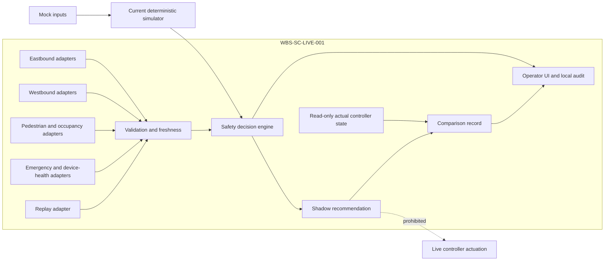

# WBS-SC-LIVE-001 — Controlled Shadow-Mode Foundation

Status: implementation candidate; not project-owner accepted. Scope excludes public-road actuation, production deployment, real ANPR retention, and external agency notification.

## 1. Repository assessment and baseline

| Capability | Classification | Evidence / gap |
|---|---|---|
| Normal and School simulations; 20 shared violations plus school-zone case | Implemented and verified | `lib/simulation.ts`, `lib/motion.ts`, unit and browser tests |
| Deterministic conflict resolver and STOP-before-WALK | Implemented and verified | `lib/safety-orchestrator.ts` |
| Heavy traffic, emergency priority, camera degradation, push-button fallback | Implemented and verified as simulation | `lib/heavy-traffic.ts`, `lib/emergency-priority.ts`, `lib/camera-fallback.ts` |
| Operator and technical event views | Implemented and verified as local records | `components/event-log.tsx` |
| Authentication | Implemented; demonstration boundary only | `lib/demo-auth.ts`; not production RBAC |
| Durable storage and tamper-evident audit | Missing | In-memory simulation records only |
| Field protocols and device identity | Blocked by external information | Vendor/controller/site details required |
| Live signal output | Intentionally disabled | Prohibited under this WBS |
| Real external alerts | Simulation only | Local mock queue; no dispatch |
| Observability | Partial | Vercel runtime logs; no field-device telemetry pipeline |
| Privacy/ANPR governance | Partial documentation | Synthetic plates only; Malaysian legal/MPAJ confirmation required |

## 2. Current and target architecture

The target isolates vendor adapters from deterministic logic. Simulation, HIL, Shadow, Supervised, and Live Restricted are explicit modes. The shipped default is `SIMULATION`; physical actuation is false. `LIVE_RESTRICTED` configuration is invalid without all explicit gates and remains out of scope.

## 3. Requirements traceability and acceptance matrix

| AC | Requirement | Evidence | Status |
|---:|---|---|---|
| 1 | Inventory/classification | This document §1 | PASS |
| 2–5 | Separation, five modes, safe default, contracts | `lib/live-integration/*` | PASS |
| 6 | Mock/replay safety paths | adapters and focused tests; full 21-scenario replay not yet authored | PARTIAL |
| 7–9 | Independent directions, configurable zones, determinism | config schema and shadow tests | PASS |
| 10–16 | Conflicts, clearance, priority, timing, degradation, stale input | existing safety tests plus focused foundation tests | PASS for software simulation |
| 17 | Existing scenario preservation | existing regression suite | PASS |
| 18 | Eight cross-feature combinations | `tests/live-integration-red-team.test.ts` | PASS |
| 19–21 | Reconstructable decisions and operator/technical views | hash-verifiable shadow record and event-log UI | PARTIAL; no durable append-only audit store |
| 22 | No hard-coded credentials | existing server-side environment boundary | PASS |
| 23 | Automated checks | execution record in delivery response | Pending execution |
| 24–25 | Architecture/docs/dependencies | This document | PASS |
| 26 | No live actuation by default | config schema and tests | PASS |
| 27 | Rollback documented/tested where feasible | §11; code rollback not executed in dirty worktree | PARTIAL |

## 4. Device and API contracts

`FieldInputAdapter<T>` defines connect, disconnect, health, and timestamped reads. Every observation includes source identity, device kind, observation/receipt times, sequence, confidence, health, and value. `validateObservation` rejects invalid timestamps, future data, stale data, invalid confidence, and failed/disconnected devices. `MockAdapter` and `InMemoryReplayAdapter` are implemented. `PendingVendorFieldAdapter` deliberately fails closed until protocols are confirmed.

Required adapters: two CCTV directions, vehicle radar, pedestrian detection, crossing occupancy, emergency detection, push button, signal controller, accessibility output, edge gateway, operator alert, and legally authorised ANPR. Retry, reconnection, authentication, replay protection, and vendor-specific encoding remain contract requirements, not invented implementations.

## 5. Operating modes and command boundary

| Mode | Inputs | Output | Physical actuation |
|---|---|---|---|
| SIMULATION | Deterministic mock | Simulated state and audit | Never |
| HARDWARE_IN_LOOP | Bench devices/emulator | Test controller proposal | Never on public road |
| SHADOW | Read-only field/emulated data | Recommendation + actual-state comparison | Never |
| SUPERVISED | Validated input + authenticated operator | Bounded recommendation | Never under this WBS |
| LIVE_RESTRICTED | Approved field deployment | Restricted command | Disabled; future formal gate only |

## 6. Deterministic state and priority specification

Priority is: collision prevention → pedestrian clearance → unverifiable conflict/all-red → sensor fail-safe → emergency conflict/validation → single protected emergency passage → controlled recovery → bounded congestion service → pedestrian service → normal operation.

| Concurrent condition | Deterministic result | Rejected alternative |
|---|---|---|
| Pedestrian in crossing + emergency | Pedestrian clearance, both traffic STOP | Emergency passage until clear |
| Conflicting verified emergencies | Emergency validation hold | Simultaneous passage |
| Stale/failed/contradictory input | Degraded safe hold | AI-authorised release |
| Heavy traffic + stored pedestrian demand | Bounded vehicle phase; demand retained | Discard/indefinite delay |
| Stop-line intrusion + any lower priority | Collision prevention | WALK, GREEN, emergency passage |
| Clear route + pedestrian demand | Both traffic STOP, WALK | Conflicting GREEN |

`evaluateShadowDecision` produces a deterministic correlation ID from canonicalised configuration version and inputs, records the chosen rule, rejected alternatives, comparison result, software/configuration version, and always records `actuationAttempted: false`.

## 7. Configuration and detection zones

The validated schema covers crossing type, mode, bilateral detection distances, speed/queue thresholds, phase bounds, clearance and wait targets, emergency/decision confidence, stale timeout, retention, and actuation gates. Forty metres is a configurable starting assumption only. Calibration requires posted/measured speed, geometry, lanes, sight/braking distance, device specifications, mounting, weather/light, latency, school context, and site survey.

## 8. Failure and fallback matrix

| Failure | Minimum response | Recovery gate |
|---|---|---|
| One camera degraded | Use independent inputs; conservative timing; operator indication | Stable validated observations |
| Stale/contradictory safety input | STOP/WAIT safe hold; manual review | Fresh independent agreement |
| Controller communication loss | No command; record comparison unavailable | Authenticated link plus state reconciliation |
| Push-button repetition | Deduplicate demand; retain audit | Button release/debounce health |
| Clock drift | Quarantine timestamps | Synchronisation within approved bound |
| Storage/event pipeline failure | Alert operator; preserve local bounded queue where designed | Integrity and capacity check |
| Critical uncertainty | Documented all-red/safe state subject to controller design | Engineer-approved recovery procedure |

## 9. Security, privacy, health, and retention controls

Existing credentials remain server-side. Per-source observation replay rejection and hash-verifiable shadow records are implemented, but production RBAC, least privilege, time-limited overrides, device certificates, signed messages, rate limits, encrypted durable append-only storage, backup/restore, update signing, and field-tested rollback are not yet implemented. ANPR/imagery must be minimised, access-restricted, purpose-limited, and retained only under approved Malaysian/MPAJ policy.

Health records must cover both cameras, radar, pedestrian/occupancy sensors, button, controller, accessibility output, edge gateway, network, clock, storage, event pipeline, decision engine, and alert delivery without secrets or unnecessary identifiers.

## 10. Test and HIL specification

Automated: schema boundaries, non-actuating default, invalid live gates, stale/future/failed observations, mock/replay lifecycle, deterministic decisions, and pedestrian/emergency priority. Existing suites cover scenario sequencing, countdowns, emergency, heavy traffic, degradation, UI, responsive behavior, authentication, and event logs.

HIL remains NOT TESTABLE locally. Bench testing must verify electrically isolated controller I/O; vendor protocol conformance; stale/duplicate/out-of-order frames; clock drift; network loss/recovery; controller rejection; amber/all-red bounds; occupancy under emergency request; watchdog/fail-safe; accessibility output; signed device identity; and evidence timestamps. No public-road connection is permitted during HIL.

## 11. Shadow-mode procedure and rollback

1. Approve site/config version and device inventory.
2. Confirm output path is physically/logically read-only.
3. Synchronise clocks and verify device identities.
4. Run replay/HIL acceptance before field connection.
5. Start read-only collection; compare recommendations with actual controller state.
6. Alert on stale/conflicting data; never infer safety from silence.
7. Review discrepancies daily with authorised engineers.
8. Stop shadow processing on audit, clock, storage, or safety-health failure.

Rollback: disable adapters, return mode to `SIMULATION`, revoke field credentials, preserve evidence, restore the last approved configuration/version, run deterministic regression, and require owner/engineer approval before reconnecting. Current feasibility: configuration rollback is specified but not field-tested.

## 12. Field-site information request

Required: exact site/crossing geometry, speed limits and surveys, traffic/pedestrian counts, signal controller make/firmware/protocol/timing plan, electrical isolation design, device models/calibration/mounting/FOV, network topology/latency/ownership, time source, accessibility equipment, school schedules/guards, MPAJ operating roles, alert recipients, retention/evidence policy, Malaysian privacy/legal assessment, enforcement authority, emergency-agency interface authority, maintenance/SLA, cybersecurity authority, fail-safe plan, and approval chain.

## 13. Red-team handoff, owner checklist, and integrated gate

Adversarial tests: pedestrian WALK + emergency; heavy traffic + emergency; heavy traffic + pedestrian; degraded camera + request; sensor disagreement + speeding; blocked zebra + demand; override + controller loss; School + emergency; spoofed identity; stale/replayed frames; opposing emergencies; clock drift; storage loss; audit mutation; privilege misuse; unsafe recovery; misleading operator text.

Findings must contain ID, scenario, preconditions, reproduction, evidence, impact, severity, requirement, correction, and retest. Closure statuses are CLOSED, PARTIALLY CLOSED, NOT CLOSED, or NOT TESTABLE. This implementation does not self-close independent findings.

Owner checklist: review delivered scope, demonstrations, matrix, open findings, residual risks, operating constraints, external dependencies, and next WBS. Only the owner may mark ACCEPTED, ACCEPTED WITH CONDITIONS, REJECTED, or DEFERRED. The subsequent integrated gate must cover all existing scenarios and may return GATE PASS, CONDITIONAL PASS, GATE FAIL, or BLOCKED for entry to WBS-SC-LIVE-002. It must never enable live actuation automatically.
