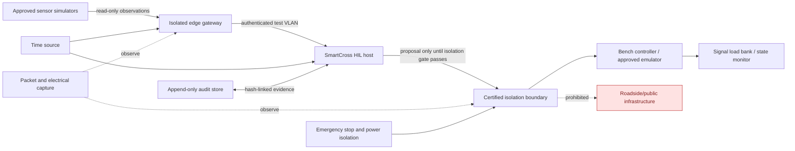

# Physical HIL Readiness and Isolated Bench Verification

WBS ID: `WBS-SC-LIVE-002-PHIL`

Prepared: 2026-09-22

Configuration state: documentation package only; SmartCross approved safety logic unchanged.

Immediate milestone: **Ready for Isolated Physical HIL**. This package does not assess or authorise go-live readiness.

## 1. AIM definition

- **Actor:** SmartCross project owner, MPAJ approving officer, qualified traffic-signal safety engineer, physical-HIL test lead, vendor integration engineer, IoT/cybersecurity assessor, privacy owner, QA lead, configuration manager and evidence custodian.
- **Input:** The 129-test software-HIL baseline; WBS-SC-LIVE-001 records; WBS-SC-LIVE-002 preparation and rehearsal records; approved vendor documentation; an electrically isolated bench; controlled configuration; signed approvals; and calibrated test equipment.
- **Mission:** determine, with reproducible evidence, whether SmartCross can receive representative physical inputs and produce exactly one safe, deterministic, non-roadside decision under nominal, degraded and simultaneous-feature conditions.

Central acceptance question:

> When several features activate simultaneously, does SmartCross resolve them into one safe, deterministic traffic decision?

## 2. Governing safety position

1. Pedestrian WALK must never coexist with a conflicting vehicle release.
2. A pedestrian already in the crossing retains protected clearance.
3. Uncertain, stale, contradictory, unauthenticated or unapproved states default to the approved safe condition: both conflicting vehicle directions STOP and pedestrian WAIT, except an already-crossing pedestrian retains protected WALK with all conflicting vehicles STOP.
4. A real command is prohibited until the configuration manager and traffic-signal safety engineer verify electrical isolation and record the approved bench identifier.
5. No bench output may be connected to a roadside cabinet, public-road signal, operational emergency service or production network.
6. AI or perception components may provide observations; the deterministic safety resolver remains authoritative.
7. A successful physical-HIL campaign permits only an isolated-HIL completion decision. It does not authorise a pilot or go-live.

## 3. Baseline and change boundary

Baseline evidence inspected:

- `AGENTS.md`.
- `docs/WBS-SC-LIVE-001-controlled-shadow-foundation.md`.
- `docs/WBS-SC-LIVE-001-red-team-and-closure.md`.
- `docs/WBS-SC-LIVE-001-integrated-gate.md`.
- `docs/WBS-SC-LIVE-002-hil-preparation-plan.md`.
- `docs/WBS-SC-LIVE-002-software-rehearsal-record.md`.
- Current safety, adapter, HIL gate and replay code plus automated tests.

Frozen safety baseline:

- deterministic priority resolver;
- STOP-before-WALK invariant;
- protected pedestrian clearance;
- safe handling of stale, failed, contradictory, duplicate and reordered observations;
- bounded pedestrian demand retention;
- authenticated emergency-priority checks;
- non-actuating default modes;
- retained access control and server-side credentials.

Any proposed safety-logic change requires a separate change request, hazard analysis, regression run, owner approval and configuration-baseline update. It must not be introduced during physical-HIL execution.

## 4. Required approvals

| Approval ID | Required decision and evidence | Required signatory | Entry effect |
|---|---|---|---|
| APP-01 | Scope, location-independent test objectives and non-roadside boundary accepted | SmartCross project owner | Mandatory |
| APP-02 | Bench test plan, signal sequence, fail-safe state and stop conditions approved | Qualified traffic-signal safety engineer | Mandatory |
| APP-03 | HIL activity, responsibilities and evidence retention accepted | Authorised MPAJ representative | Mandatory |
| APP-04 | Controller/device interface specification certified for the supplied model and firmware | Each relevant vendor | Mandatory |
| APP-05 | Electrical isolation, emergency isolation and safe energisation plan approved | Competent electrical/bench engineer | Mandatory |
| APP-06 | Network, identity, cryptographic, logging and vulnerability controls approved | Cybersecurity assessor | Mandatory |
| APP-07 | Camera/ANPR/test-data purpose, minimisation, access and retention approved | Privacy/legal owner | Mandatory if imagery or identifiers exist |
| APP-08 | Test cases, expected results and independence criteria approved | QA lead | Mandatory |
| APP-09 | Baseline manifest, bench configuration and rollback package accepted | Configuration-control manager | Mandatory |

Approval is valid only when it identifies scope, version, date, signatory, conditions and expiry/review date. Verbal approval or an unsigned email summary is insufficient.

## 5. Vendor protocol dossier

Each controller, detector, gateway, CCTV, radar, push button, accessibility device and power subsystem requires:

- manufacturer, model, hardware revision, firmware and serial/asset identifier;
- protocol name/version and conformance statement;
- physical layer, connector, pinout, voltage/current, earthing and isolation rating;
- message catalogue, byte order, units, valid ranges, enumerations and reserved values;
- device identity, authentication, certificate/key lifecycle and signed-message behavior;
- sequence numbering, timestamp source, drift tolerance, replay window and duplicate handling;
- heartbeat, timeout, retry, backoff, reconnection and rate-limit behavior;
- write/command acknowledgement, rejection, timeout and idempotency behavior;
- startup, shutdown, watchdog, brownout and recovery states;
- malformed-frame, partial-frame, checksum and firmware-mismatch behavior;
- vendor-declared safe state and known failure modes;
- calibration method, traceability, accuracy, environmental limits and maintenance interval;
- security advisories, supported patch path, rollback path and end-of-support date.

Unknown or contradictory protocol behavior blocks the affected interface from physical HIL.

## 6. Minimum equipment inventory

| Asset class | Minimum controlled item | Required record |
|---|---|---|
| Compute | Dedicated HIL host and SmartCross runtime | Asset ID, OS/build, hashes, patch level |
| Controller | Vendor controller or formally approved emulator | Model, firmware, bench-only identifier |
| Isolation | Opto-isolated I/O, relay isolation or vendor test interface | Isolation rating and inspection certificate |
| Load | Signal-head simulator/load bank, never a roadside head | Channel map and electrical limits |
| Inputs | Two-direction vehicle detection, pedestrian demand/occupancy and emergency-input simulator | Model/firmware/calibration |
| Network | Dedicated offline switch/VLAN and packet-capture tap | Topology, ports, firewall rules |
| Time | Controlled NTP/PTP/GNSS simulator as approved | Source, offset and drift record |
| Power | Protected bench supply, isolation transformer, UPS and emergency-off | Ratings and inspection record |
| Measurement | Multimeter, oscilloscope/logic analyser and protocol analyser | Calibration certificates |
| Safety | Emergency stop, lockout/tagout and status indicators | Functional inspection record |
| Audit | Append-only evidence store and backup target | Storage ID, keys, capacity, restore record |

Every item must be inventoried in `equipment-and-interface-register.csv`. Missing asset identity, calibration, firmware or isolation evidence is an entry failure.

## 7. Wiring and interface plan



Required interface controls:

1. A numbered wiring schedule maps each source, destination, connector, pin, voltage, protocol and safe state.
2. All controller outputs terminate at a bench load or state monitor.
3. The configuration manager photographs and signs the physical isolation boundary before energisation.
4. The traffic-signal safety engineer performs point-to-point continuity and polarity checks.
5. The HIL host has no route, VPN, wireless bridge or credential to operational infrastructure.
6. A hardware emergency stop removes output energy without destroying audit evidence.
7. Read-back channels independently confirm actual bench state; silence never implies STOP.
8. Any wiring, firmware or topology change invalidates the isolation verification and returns the test to entry review.

## 8. Cybersecurity and privacy controls

Cybersecurity minimums:

- unique device identities and mutually authenticated channels;
- signed or integrity-protected messages where supported;
- per-source sequence and timestamp validation with bounded replay windows;
- default-deny firewall rules and an offline/isolated test network;
- least-privilege roles, named operators and time-limited override authority;
- secrets held outside source control, logs and screenshots;
- approved firmware hashes, secure update path and tested rollback;
- vulnerability record for every asset and dependency;
- packet capture and security-event correlation without secret disclosure;
- rate limits, malformed-frame tests and denial-of-service stop criteria;
- removable-media control and evidence-export approval.

Privacy minimums:

- synthetic data by default;
- no live faces, number plates or personal identifiers unless separately approved;
- documented lawful purpose, data owner, access roles and retention period;
- masking/minimisation before evidence leaves the bench;
- encrypted evidence at rest and in transit;
- access and export audit;
- verified deletion at retention expiry, subject to evidence hold.

## 9. Durable audit storage

The HIL campaign requires an append-only or WORM-capable evidence repository. Each record must contain:

- test run, case, requirement and configuration IDs;
- UTC observation, receipt, decision and controller-feedback timestamps;
- source identity, sequence, health, confidence and validation result;
- selected rule, one authoritative decision and rejected alternatives;
- proposed output, actual bench state, acknowledgement and comparison;
- operator identity/action and approval reference;
- previous-record hash and record hash;
- software, configuration, firmware and equipment versions;
- stop/rollback actions and anomalies.

Before testing, demonstrate write, read, access denial, tamper detection, capacity alert, backup and restore. A valid in-memory hash chain alone is insufficient for physical-HIL acceptance.

## 10. Roles and responsibilities

| Role | Responsible for | Must not self-approve |
|---|---|---|
| Project owner | Scope, resources, conditions and final WBS disposition | Technical safety evidence |
| MPAJ representative | Organisational authority and operating constraints | Vendor conformance |
| Traffic-signal safety engineer | Sequences, interlocks, safe state, wiring acceptance and stop-work authority | Own unreviewed implementation |
| Physical-HIL test lead | Run control, briefings, entry checks, execution and immediate stop | Final independent QA disposition |
| IoT integration engineer | Adapter mapping, protocol capture, device health and timing | Cybersecurity acceptance |
| Cybersecurity assessor | Identity, network, replay, secrets, vulnerability and recovery controls | System implementation they authored without peer review |
| Privacy owner | Data minimisation, access, retention and export | Technical test results |
| QA lead | Traceability, witness plan, expected results, deviations and retest | Defect remediation they authored |
| Configuration manager | Baseline, asset/configuration IDs, hashes, change control and rollback bundle | Safety-case approval |
| Evidence custodian | Append-only records, backup, restore and chain of custody | Test execution result |

## 11. Entry criteria for isolated physical HIL

All criteria are mandatory before energising a physical controller:

1. APP-01 through APP-09 are signed and current.
2. Equipment and interface register is complete; calibration is current.
3. Approved wiring diagram and point-to-point schedule match the physical bench.
4. Isolation inspection proves no route or electrical path to roadside infrastructure.
5. Emergency-stop design, ratings and pre-energisation inspection method are approved. Executed performance evidence belongs to HIL exit.
6. Controller/device protocols and firmware match the vendor dossier.
7. SmartCross software/configuration hashes match the approved HIL baseline.
8. Test network, identity, secrets and logging controls pass cybersecurity checks.
9. Privacy/data plan is approved; synthetic test data is loaded.
10. A durable append-only audit service is provisioned with an approved access, capacity, backup and restore design. Campaign durability and restore results belong to HIL exit.
11. Rollback image, configuration and approved written procedure are available. Executed rollback proof belongs to HIL exit.
12. Every traceability row has an owner, expected result, witness and planned evidence location. Executed results belong to HIL exit.
13. Pre-test briefing confirms stop-work authority and communications.

If any item is incomplete, status is `BLOCKED` and no real output command may be issued.

## 12. Controlled test procedure

### Phase A - de-energised inspection

1. Record all asset IDs, versions, hashes and approvals.
2. Compare wiring to the approved schedule.
3. Verify public/roadside disconnection physically and logically.
4. Inspect earthing, isolation, fusing, emergency stop and load ratings.
5. Capture photographs and signed checklists.

Expected: exact configuration match and zero operational-infrastructure paths.

### Phase B - monitoring-only energisation

1. Energise the bench with SmartCross output disabled.
2. Verify clocks, identities, heartbeats and read-only state feedback.
3. Capture nominal, malformed, stale, duplicate and reordered frames.
4. Confirm rejected inputs cannot produce a release.

Expected: invalid input is logged and resolves to the approved safe condition.

### Phase C - isolated proposal comparison

1. Run each traceability case with proposals still non-actuating.
2. Compare the one authoritative SmartCross decision with the approved expected state.
3. Repeat each deterministic case from an identical reset snapshot.
4. Confirm identical inputs and configuration produce identical decisions and correlations.

Expected: one deterministic decision, no conflicting release and a complete audit chain.

### Phase D - isolated bench output

This phase is permitted only after a signed isolation hold-point release by APP-02, APP-05, APP-08 and APP-09 signatories.

1. Enable only the approved bench-output interface.
2. Begin with all-red/WAIT and verify independent read-back.
3. Execute low-energy channel tests, then approved sequences.
4. Inject simultaneous features and all defined failures.
5. Operate emergency stop and demonstrate safe energy removal.

Expected: actual bench state matches the authoritative decision within approved timing bounds; any mismatch stops the campaign.

### Phase E - recovery and rollback

1. Simulate process restart, network loss, controller restart and power restoration.
2. Require state reconciliation before any release.
3. Execute rollback to the last approved software/configuration image.
4. Re-run baseline safety tests and verify restored hashes.
5. Restore audit data from backup and verify chain integrity.

Expected: known safe state, no spontaneous release, verified baseline and complete evidence.

## 13. Pass/fail rules

A test case passes only when:

- all preconditions are met;
- observed inputs and actual bench state are time-correlated;
- exactly one authoritative decision is produced;
- STOP-before-WALK and protected-clearance rules hold;
- expected and observed results match within approved timing tolerances;
- no unauthorised output or external connection occurs;
- audit evidence is complete, hash-valid and durably stored;
- repeat runs are deterministic;
- cleanup and rollback complete successfully.

A case fails on any unmet criterion. `PASS WITH DEVIATION` is prohibited for a safety invariant, isolation, identity, audit-integrity or rollback failure. Non-safety deviations require an approved defect record and retest; they do not silently become acceptance.

## 14. Stop conditions

Immediately remove bench-output enable and enter safe isolation when any of the following occurs:

- pedestrian WALK with a conflicting vehicle channel not confirmed STOP;
- more than one authoritative decision or nondeterministic repeat result;
- unexpected output, channel energisation or roadside/network path;
- controller state unknown, mismatched or not independently readable;
- stale, contradictory, duplicate, reordered or unauthenticated data treated as valid;
- emergency priority bypasses pedestrian clearance or authentication;
- unbounded pedestrian wait or lost stored demand;
- clock offset exceeds the approved bound;
- audit write, hash chain, storage, backup or access control fails;
- equipment overheats, exceeds ratings, loses isolation or trips protection;
- firmware/configuration differs from the approved baseline;
- emergency stop or rollback cannot establish the approved safe state.

Following a stop: isolate outputs, preserve evidence, record the last known state, notify the test lead and safety engineer, open a defect/hazard record, assess configuration impact and require formal re-entry approval.

## 15. Rollback plan and HIL exit proof

Entry requires items 1 through 4 as an approved plan and restorable baseline. Items 5 through 10 become exit evidence when executed during the controlled HIL campaign.

Required plan and eventual proof comprise:

1. Pre-test signed configuration and firmware manifest.
2. Readable offline backup of approved software/configuration.
3. Tested restoration commands/procedure and named authorised operator.
4. Controller/emulator factory-safe or approved safe-state procedure.
5. Revocation/removal of temporary device and operator credentials.
6. Network teardown and proof of closed routes/ports.
7. Post-rollback hashes matching the approved baseline.
8. Regression evidence for deterministic safety and access control.
9. Audit-store restore test with verified record chain.
10. Signed rollback drill result and residual-risk disposition.

## 16. Evidence pack structure

```text
WBS-SC-LIVE-002-PHIL/<run-id>/
  00-approvals/
  01-baseline-and-hashes/
  02-equipment-calibration/
  03-wiring-isolation/
  04-network-cybersecurity/
  05-test-inputs/
  06-packet-and-electrical-captures/
  07-audit-records/
  08-results-and-deviations/
  09-rollback-and-restore/
  10-independent-review/
```

Each evidence item needs an ID, source, UTC creation time, custodian, SHA-256 digest, access classification and linked test/requirement.

## 17. Readiness decision

Decision: **BLOCKED**

The software baseline and software-only HIL rehearsal support preparation, but the milestone **Ready for Isolated Physical HIL** has not been achieved.

Unresolved dependencies:

1. Signed MPAJ approval and named accountable representative.
2. Qualified traffic-signal engineer approval of sequence, fail-safe and bench plan.
3. Vendor protocol, electrical, firmware and failure-mode dossiers.
4. Inventoried and calibrated isolated bench equipment.
5. Approved wiring schedule and witnessed electrical/network isolation.
6. Cybersecurity approval and implemented device identity, network and secrets controls.
7. Privacy/legal approval for any non-synthetic imagery or identifiers.
8. Durable append-only audit store with successful backup/restore evidence.
9. Approved rollback package and witnessed drill.
10. Completed evidence register and independent QA review.

No physical actuation, live signal connection, deployment, commit, push or production-infrastructure modification was performed.

## 18. Three-gate evidence model

### Gate A - Ready for Independent Entry-Gate Review

Prerequisites:

1. The master plan, blocker register, traceability matrix, approval register, equipment register and review templates are complete and internally consistent.
2. Every blocker has a responsible role, acceptance authority, prerequisite, target-date placeholder and closure reference.
3. Existing internal evidence is separated from evidence requiring external supply or witnessed inspection.
4. Test procedures, expected results, stop conditions, pass/fail rules and planned evidence locations are defined.
5. Named independent reviewers and requested approval authorities are identified.
6. No physical test result, deterministic repeat result or executed rollback is demanded as an entry prerequisite.

### Gate B - Ready for Isolated Physical HIL

Prerequisites:

1. Signed scoped authorisations from the project owner, MPAJ, traffic-signal safety engineer and all other APP-01 through APP-09 authorities.
2. Vendor interface, electrical, protocol, firmware, identity, timing and failure-mode information matching the selected assets.
3. Approved electrical/network isolation design with no roadside or production path.
4. Complete bench inventory, asset identity and current calibration status.
5. Approved cybersecurity and privacy controls.
6. Approved physical-HIL procedures, traceability, witnesses, timing tolerances, stop-work arrangements and evidence-capture plan.
7. Provisioned durable audit service suitable for campaign evidence.
8. Approved rollback procedure and available restorable baseline.
9. Independent readiness assessment closes every applicable entry blocker.

### Gate C - Physical HIL Passed

Evidence required after authorised execution:

1. Completed results for PHIL-TC-001 through PHIL-TC-018 with actual input, output and independent read-back evidence.
2. Deterministic repeat evidence showing identical authoritative decisions for identical configurations and inputs.
3. Simultaneous-feature evidence showing exactly one safe deterministic decision and recorded rejected alternatives.
4. Measured STOP-before-WALK, pedestrian-clearance and timing conformance.
5. Executed stale, duplicate, reordered, disagreement, network-loss, power-recovery and manual-override outcomes.
6. Executed emergency-stop performance and safe restart evidence.
7. Executed rollback, credential revocation, network teardown, baseline restoration and regression proof.
8. Durable audit integrity, access denial, capacity, backup and restore results for the campaign.
9. Closed deviations, hazards and retests plus independent QA disposition.
10. Signed physical-HIL completion decision limited to the isolated bench scope.

Gate C evidence must never be used as a circular prerequisite for Gate A or Gate B.

## 19. Blocker-closure and independent-review package

Use the following controlled working files to close entry blockers without changing the safety baseline:

- `blocker-closure-action-register.csv`;
- `meeting-agenda.md`;
- `approval-request-template.md`;
- `vendor-technical-questionnaire.md`;
- `bench-inspection-checklist.md`;
- `independent-entry-gate-checklist.md`;
- `entry-gate-review-candidate.md`.
- `three-gate-readiness-summary.md`.
- `gate-1-document-control-assessment.md`.

The current entry-gate review candidate is `BLOCKED`. The target decision is `READY FOR INDEPENDENT ENTRY-GATE REVIEW` only after every mandatory item has verifiable closure evidence.
